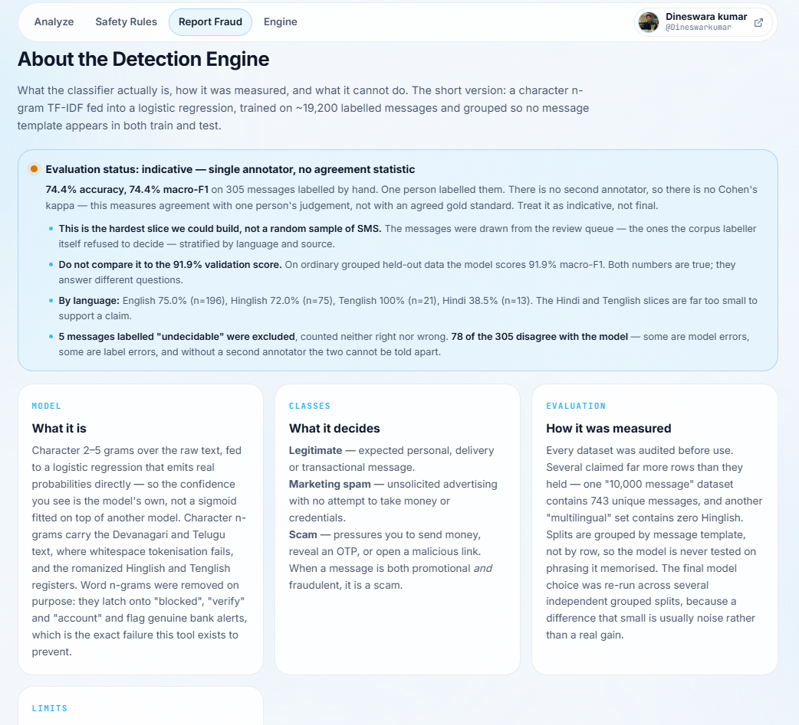
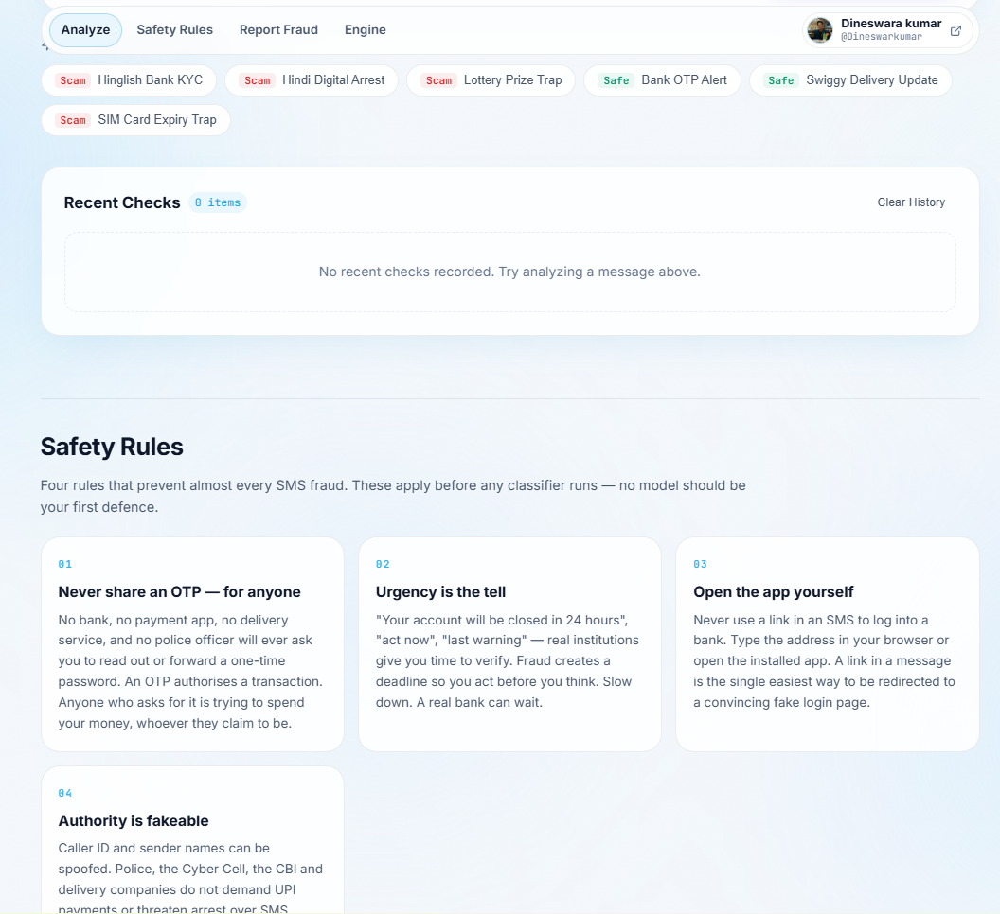
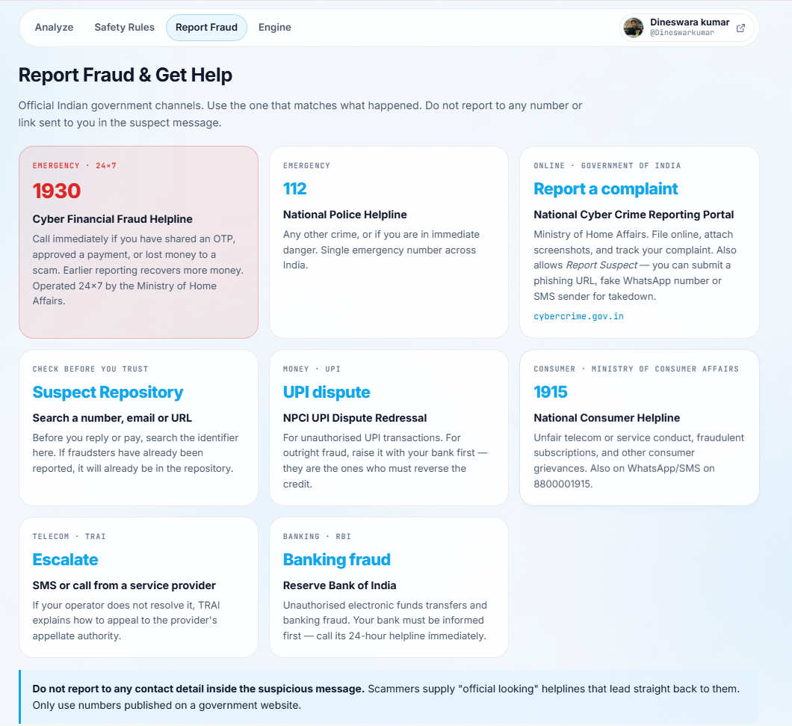

# Spam Shield

SMS and message scam checker for English, Hinglish, and Indian-language messages.

- Live demo: `https://YOUR-APP-NAME.onrender.com` *(replace after deployment)*
- Local app: `http://127.0.0.1:8000/`
- Status: prototype; not a security product

## Screenshots

| **Live Analysis (Marketing Spam)** | **Detection Engine & Metrics** |
|:---:|:---:|
| |  |

| **Safety Rules & Guidance** | **Report Fraud Channels** |
|:---:|:---:|
|  |  |


## What it does

- Labels a message as **legitimate**, **marketing spam**, or **scam**.
- Shows model results and rule signals separately.
- Includes safety guidance and official India fraud-reporting channels.
- Serves the web app and API from one FastAPI backend.

## Model

- Final model: **character TF-IDF (`char_wb`, 2–5 grams) + Logistic Regression**.
- Training artifact: 19,184 messages; 2.5 MB.
- Character n-grams avoid reliance on whole words and fit this project's code-mixed comparisons.
- Fraud rules are additive; they show extra signals and do not overwrite the model verdict.

## Benchmarks

| Evaluation | Result | Notes |
|---|---:|---|
| Grouped validation | **92.41% accuracy · 91.94% macro-F1** | 4,082 messages |
| Three-seed comparison | **93.16% ± 1.07 macro-F1** | Half-range across grouped seeds |
| Genuine-message hard negatives | **1.19% miss rate** | Grouped validation |
| Human-labelled review set | **74.43% accuracy · 74.44% macro-F1** | 305 messages; deliberately difficult review-queue sample |

Non-English review-set results: Hinglish **72.0% (n=75)**; Hindi **38.5% (n=13)**. Hindi and Telugu support is too small for reliable language-specific claims. Tenglish still needs native-speaker review.

The review-set labels came from one annotator, so there is no agreement statistic. The review-set score is not comparable to grouped validation. Full details are in [`notes/FINAL_EVALUATION.md`](notes/FINAL_EVALUATION.md).

## Model comparison

Initial comparison, before the transactional-data fixes:

| Candidate | Macro-F1 | Hard-negative miss |
|---|---:|---:|
| Word-only Logistic Regression | 88.13% | 28.5% |
| Word + character Logistic Regression | 89.29% | 26.0% |
| Character-only Logistic Regression | 90.67% | 19.3% |
| Word + character LinearSVC | 89.99% | 2.0% |

After the data and rule fixes, the candidates were re-run across three grouped seeds:

| Candidate | Macro-F1 across grouped seeds | Hard-negative miss |
|---|---:|---:|
| Word + character Logistic Regression | 92.51% ± 2.00 | 1.52% |
| **Character-only Logistic Regression (selected)** | **93.16% ± 1.07** | **1.19%** |
| Word + character LinearSVC | 91.61% ± 3.69 | 1.52% |

- Macro-F1 differences are within the selected model's seed spread; treat them as a tie.
- Selected on hard-negative behavior, lower seed spread, and direct probability output.
- Word n-grams were avoided because they can flag genuine messages containing terms like “verify” or “account”.
- Earlier LinearSVC results changed after legitimate transactional examples were added; the old advantage was caused by that data gap.
- See [`notes/MODEL_SELECTION.md`](notes/MODEL_SELECTION.md) for the earlier comparison and full rationale.

## Run locally

1. From PowerShell in the project folder:

   ```powershell
   python -m venv .venv
   .\.venv\Scripts\Activate.ps1
   python -m pip install -r backend/requirements.txt
   .\start_spam_shield.ps1
   ```

2. Open `http://127.0.0.1:8000/` if it does not open automatically.

The trained model is included at `backend/artifacts/model.joblib`. Raw datasets, generated corpora, and labelled CSV/Excel files are excluded from Git; they are needed to rebuild or independently rescore the model.

## Privacy note

- The API does not write message bodies to disk or include them in application logs.
- The browser keeps up to 10 recent messages in local storage. Use **Clear History** or browser storage controls to remove them.
- Do not paste live OTPs, passwords, or private messages into a demo deployment.

## Checks and reports

- `python scripts/test_template_labels.py` — template and guard-label fixtures.
- `python backend/test_rules.py` — runtime rule fixtures.
- `PROJECT_STATUS.md` — current project status and limitations.

Training data is not included. There is no license file yet; add one before inviting reuse or contributions.
